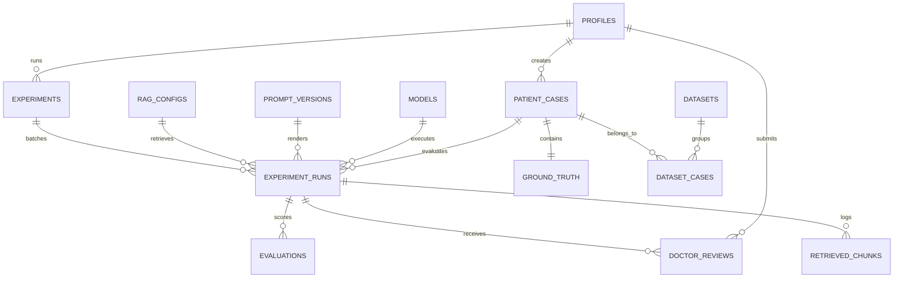

# Physio AI Evaluation Studio (DoctorSakhi)
## Architecture Blueprint & 10-Phase Implementation Roadmap

---

### Executive Overview

**Physio AI Evaluation Studio** is an enterprise‑grade healthcare AI evaluation platform belonging to the **DoctorSakhi / Physio Assistant** ecosystem. The platform bridges the clinical world of physiotherapy practice with rigorous AI evaluation engineering.

It accomplishes two fundamental missions:
1. **Clinical Practice Experience (Doctor UI)** – a calm, ultra‑simple, natural‑language and voice‑first interface where doctors capture patient cases and their own clinical ground truth without filling complex multi‑field medical forms.
2. **AI Evaluation Lab Experience (Internal AI Lab)** – an analytical, high‑density engineering suite for internal researchers to execute, compare, and benchmark multiple LLM providers, prompts, and RAG configurations against doctor‑approved ground truth across 10 evaluation dimensions.

---

### 1. Dual‑Experience Architecture (Strict Separation)

```
                                  ┌───────────────────────────────┐
                                  │      Supabase Auth & RBAC     │
                                  └───────────────┬───────────────┘
                                                  │
                      ┌───────────────────────────┴───────────────────────────┐
                      ▼                                                       ▼
        ┌───────────────────────────┐                           ┌───────────────────────────┐
        │     DOCTOR EXPERIENCE     │                           │      INTERNAL AI LAB      │
        │      (Clinical Mode)      │                           │     (Analytical Mode)     │
        ├───────────────────────────┤                           ├───────────────────────────┤
        │ • Simple Conversational UI│                           │ • Dataset Management      │
        │ • Large Natural‑Text Areas│                           │ • Case Repository         │
        │ • Whisper Voice STT       │                           │ • Model Registry (Agnostic)│
        │ • Real‑time Transcription │                           │ • Versioned Prompt Lab    │
        │ • One‑click "Run AI"      │                           │ • RAG Parameter Studio    │
        │ • Clean AI Results View   │                           │ • Side‑by‑Side Comparison │
        │ • Doctor Review Loop      │                           │ • Output Diff Engine      │
        │   (Approve/Correct/Reject)│                           │ • 10‑D Automated Eval     │
        │ • ZERO Technical Clutter  │                           │ • LLM‑as‑Judge & Safety   │
        │   (No prompts, no tokens, │                           │ • Regression Testing      │
        │    no RAG, no costs)      │                           │ • Latency & Cost Tracking │
        └───────────────────────────┘                           └───────────────────────────┘
```

---

### 2. Core Architectural Pillars

#### A. Voice Input & Transcription (`VoiceRecorderTextarea`)
- Reusable React component with 7 explicit state transitions:
  $$\text{idle} \rightarrow \text{recording} \rightarrow \text{paused} \rightarrow \text{stopping} \rightarrow \text{transcribing} \rightarrow \text{completed} \rightarrow \text{error}$$
- Integrates with backend Whisper API for high‑accuracy speech‑to‑text.
- Progressive live transcription directly into the textarea with editable draft buffer.
- Preserves raw audio link, original transcript, and doctor‑edited final text.

#### B. Ground Truth & The "No‑Inference" Principle
Information is strictly partitioned into verified provenance categories:
- `PATIENT_STATEMENTS` (Direct complaints, e.g. "pain 4/10 on stairs")
- `DOCTOR_DOCUMENTED_FACTS` (Objective exam findings)
- `DOCTOR_ASSESSMENT` (Clinical diagnosis/etiology)
- `DOCTOR_TREATMENT_PLAN` (Intended interventions & exercises)
- `AI_INFERENCE` (Model diagnostic derivation)
- `AI_RECOMMENDATION` (Model proposed intervention)

**The Cardinal Rule**: Missing details are explicitly marked as `Not Documented`. The system forbids hallucinating absent findings as `Normal` or `Negative`.

#### C. Provider‑Agnostic Model Integration
- Dynamic plug‑and‑play Model Registry supporting any OpenAI‑compatible API, Anthropic Claude, Amazon Bedrock, Ollama, or custom HTTP endpoints.
- Secret tokens remain strictly backend‑side; never exposed to browser client.
- Model configurations include temperature, top‑p, max tokens, system prompt overrides, and cost‑per‑token pricing tables.

#### D. Multidimensional Evaluation Framework (10 Dimensions)
Instead of a single misleading scalar score, AI outputs are evaluated against a rich 10‑dimensional matrix:
1. **Fact Accuracy** (Deterministic code comparison of body side, age, scores)
2. **Completeness** (Verification that critical documented findings are addressed)
3. **Groundedness** (Citation back to clinical input or retrieved literature)
4. **Hallucination / Unsupported Claims** (Identification of ungrounded diagnoses)
5. **Clinical Alignment** (Semantic congruence with doctor's clinical reasoning)
6. **Treatment Alignment** (Congruence with doctor's intended interventions)
7. **Exercise Relevance** (Anatomical & physiological appropriateness)
8. **Safety & Contraindications** (Deterministic check against forbidden exercises)
9. **Format & Schema Compliance** (Pydantic / Zod schema validation)
10. **Doctor Alignment** (Direct comparison with doctor review approvals/edits)

---

### 3. Database Schema Overview (Supabase PostgreSQL + RLS)



---

### 4. The 10 Master Execution Phases

| Phase | Title | Core Deliverables |
|---|---|---|
| **Phase 1** | **Architecture & Foundation** | Repo structure, TypeScript definitions, Vite + React setup, FastAPI backend base, API schemas, env configs. |
| **Phase 2** | **Design System & UI Library** | Tailwind v4 design tokens, Clinical vs AI Lab theme variants, Buttons, Inputs, Badges, Modals, Cards, Tabs, Loaders. |
| **Phase 3** | **Supabase & RBAC Auth** | Supabase client, Auth provider, RLS policies, Roles (`doctor`, `ai_user`, `admin`), Route guards. |
| **Phase 4** | **Doctor Clinical Experience** | Conversational case input, `VoiceRecorderTextarea` with Whisper STT, Ground Truth capture, Run AI, Doctor Review. |
| **Phase 5** | **AI Lab Workspace** | Dataset manager, Case repository, Provider‑agnostic Model Registry, Versioned Prompt Lab, RAG Studio. |
| **Phase 6** | **Multi‑Model Comparison** | Experiment runner, Synchronized 2‑4 column side‑by‑side grid, Semantic and textual output diff viewer. |
| **Phase 7** | **Automated Evaluation Engine** | 10‑D scoring pipeline: deterministic checks, semantic matcher, LLM‑as‑judge with strict rubric, safety auditor. |
| **Phase 8** | **Doctor Review Loop** | Clinical review workflow, correction taxonomy tagging, feedback dataset builder for active learning. |
| **Phase 9** | **Regression Testing Suite** | Golden dataset benchmark execution, version drift detection, automated regression reporting. |
| **Phase 10** | **Analytics & Observability** | Error taxonomy charts, latency distributions, token cost tracking, longitudinal model quality radar. |

---

### 5. Implementation Roadmap Status

- [x] **Phase 1: Architecture & Foundation** (Underway)
- [ ] **Phase 2: Design System & UI Library**
- [ ] **Phase 3: Supabase & RBAC Auth**
- [ ] **Phase 4: Doctor Clinical Experience**
- [ ] **Phase 5: AI Lab Workspace**
- [ ] **Phase 6: Multi‑Model Comparison**
- [ ] **Phase 7: Automated Evaluation Engine**
- [ ] **Phase 8: Doctor Review Loop**
- [ ] **Phase 9: Regression Testing Suite**
- [ ] **Phase 10: Analytics & Observability**

---

*End of Blueprint*
